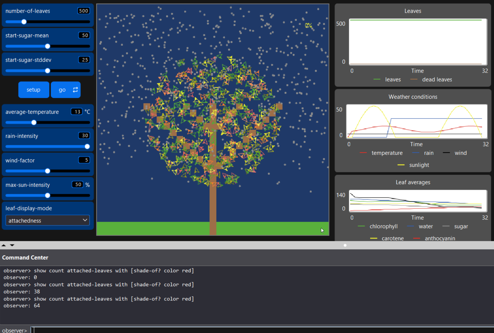
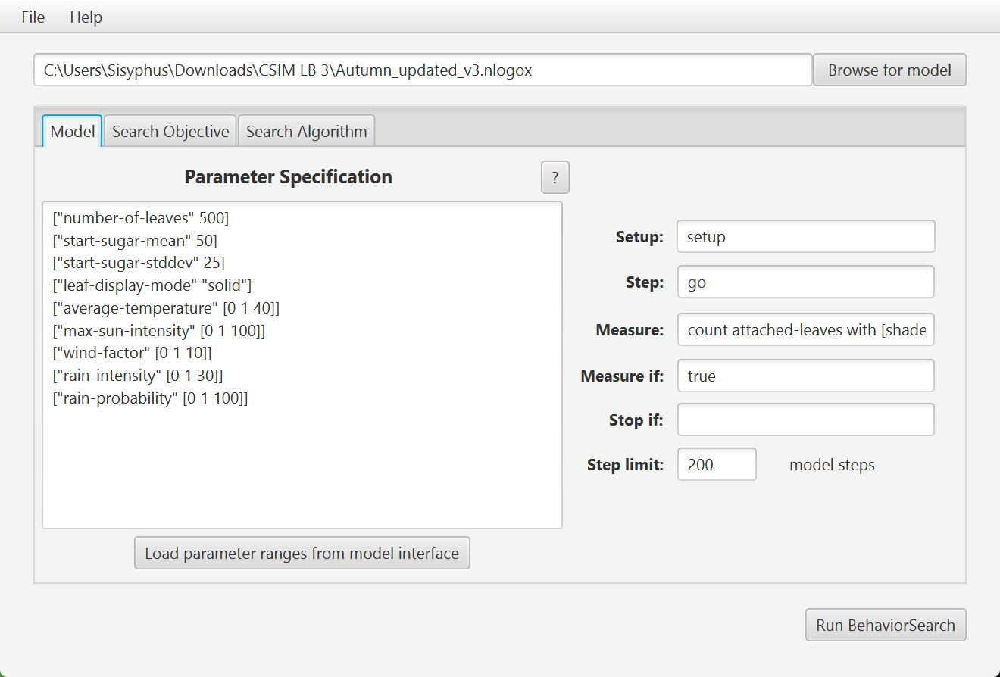
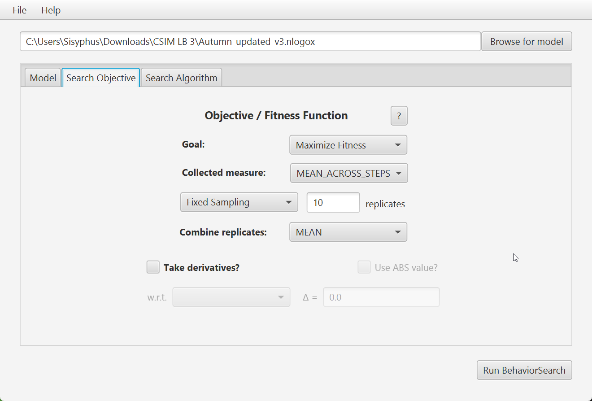
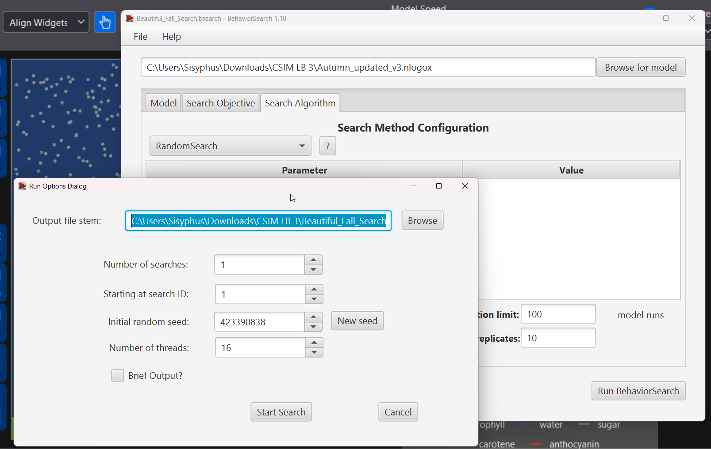
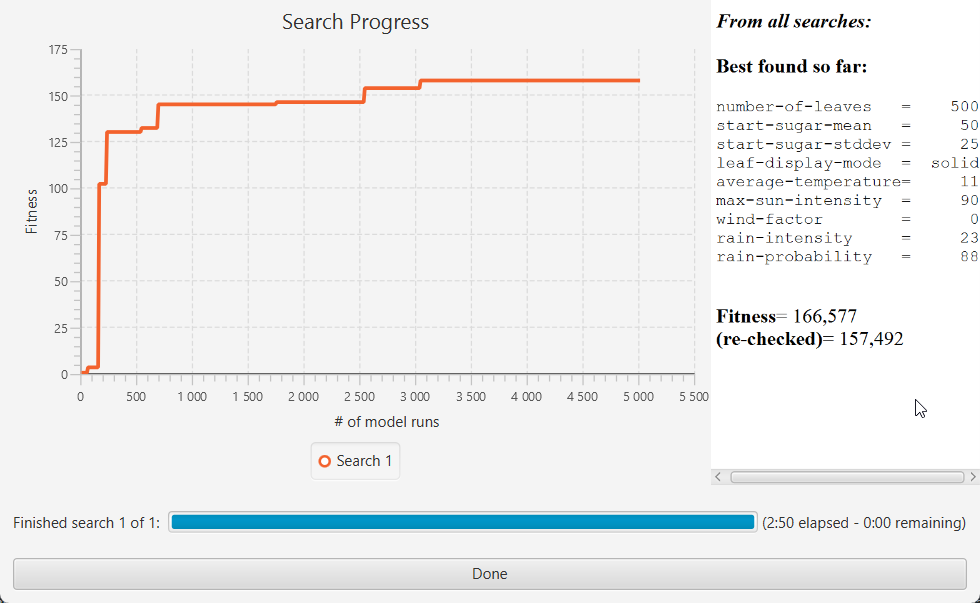
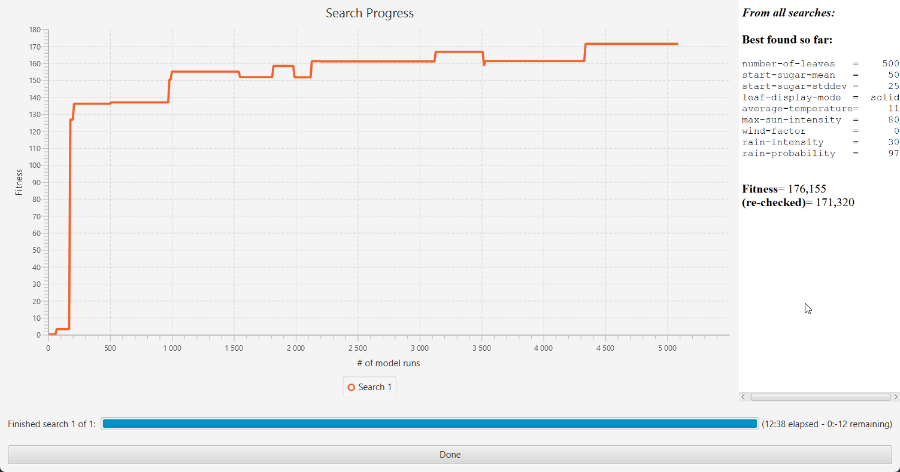
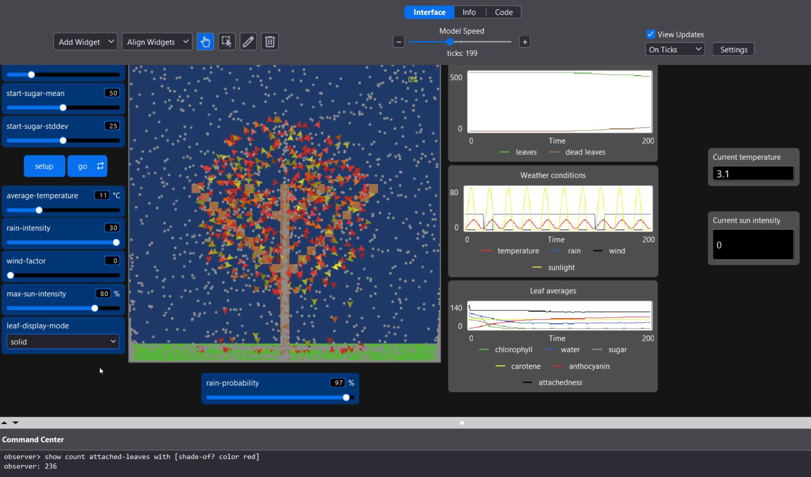

# СПм-25-1, Олешко Владислав Миколайович

## Лабораторна робота №3. Використання засобів обчислювального інтелекту для оптимізації імітаційних моделей

## Варіант 11. Модель у середовищі NetLogo - Autumn

Для роботи використовується версія моделі [Autumn](https://www.netlogoweb.org/launch#http://www.netlogoweb.org/assets/modelslib/Sample%20Models/Biology/Autumn.nlogo), змінена у другій лабораторній роботі. Файл зміненої моделі `Autumn_updated_v3.nlogox` додано до репозиторію.

### Вербальний опис моделі:
Симуляція впливу осінньої пори року на листя дерева. Модель дозволяє побачити, як листки змінюються від свого типового для теплої пори року зеленого стану до жовтого, помаранчевого чи червоного й врешті опадають з дерева під дією погодних умов, притаманних осені.

У другій лабораторній роботі модель було доповнено добовим циклом: інтенсивність сонця та температура тепер змінюються протягом модельної доби, а дощ іде не постійно, а з заданою ймовірністю.

### Керуючі параметри:
**number-of-leaves** (1–2500): визначає стартову кількість агентів у середовищі моделювання -> в обраній моделі це задає кількість листя на дереві у симуляції.

**start-sugar-mean** (0–100): визначає важливу характеристику агента на старті -> в обраній моделі це середній вміст цукру у кожному окремому листочку дерева.

**start-sugar-stddev** (0–50): визначає стандартне відхилення параметру вище -> в обраній моделі це контролює наскільки різними можуть бути агенти (листочки) за вмістом цукру. Тобто або листочки будуть мати приблизно однакову кількість цукру (за меншого показника) або ж деякі матимуть багато, а деякі майже нічого (за вищого показника).

**average-temperature** (0–40 °C): визначає середньодобову температуру повітря. Поточна температура коливається навколо цього значення протягом доби: амплітуда коливань залежить від max-sun-intensity (до ±10 градусів при 100%), а пік температури настає із запізненням відносно піку сонця. Температура є головним осіннім чинником, що впливає одразу на кілька процесів: нижче 20 градусів листок перетворює цукор і воду на антоціан (червоніє); нижче 15 градусів руйнується хлорофіл, чим холодніше - тим швидше; нижче 10 градусів листок перестає поглинати воду, а вище 30 градусів вода з листка випаровується.

**max-sun-intensity** (0–100%): визначає максимальну (полуденну) інтенсивність сонячного освітлення. Вдень поточна інтенсивність зростає від 0 до цього значення й спадає назад (за синусом), а вночі дорівнює 0. При поточній інтенсивності понад 20% вмикаються фотосинтез і відновлення хлорофілу, а понад 75% хлорофіл руйнується, тим сильніше чим яскравіше сонце. Візуально відображається розміром і кольором сонця.

**rain-intensity** (0–30): визначає інтенсивність опадів -> в обраній моделі це кількість крапель дощу, що з'являються на кожному такті, поки йде дощ (кожна несе 10 одиниць води). Краплі падають на землю, через коріння та стовбур піднімаються до крони і розходяться між листками; листок поглинає 20% води найближчої краплі.

**rain-probability** (0–100%): визначає ймовірність дощу. Двічі на добу (на світанку та на заході сонця, тобто кожні 10 тактів) модель вирішує, чи йтиме дощ наступні півдоби. Якщо так - краплі з'являються з інтенсивністю rain-intensity, якщо ні - дощу немає.

**wind-factor** (0–10): визначає силу вітру -> в обраній моделі це величина, на яку на кожному такті зменшується прикріпленість кожного листка. Також визначає наскільки сильно листок зносить убік під час падіння і як швидко він падає.

**leaf-display-mode**: змінює лише спосіб відображення листків і не впливає на поведінку моделі.

### Внутрішні параметри моделі:
**day-length** (20): тривалість модельної доби у тактах.

**temp-amplitude** (10): амплітуда добових коливань температури при інтенсивності сонця 100%.

**temp-lag** (45): запізнення зміни температури відносно сонця, у градусах фази (1/8 доби, тобто 2,5 такту).

### Внутрішні параметри листків:
**water-level**: запас води в листку, на старті 75–100. Поповнюється з крапель дощу (лише при температурі від 10 градусів), витрачається на фотосинтез (0,5 за такт) та утворення антоціану (1 за такт), випаровується при температурі понад 30. Якщо води менше 25 - листок слабне (прикріпленість −1 за такт); якщо менше 1 - листок одразу відривається.

**sugar-level**: запас цукру в листку, на старті генерується за нормальним розподілом з параметрами start-sugar-mean та start-sugar-stddev. Збільшується на 1 при фотосинтезі, витрачає 0,5 кожен такт на підтримку життєдіяльності та 1 при утворенні антоціану.

**attachedness**: прикріпленість листка до дерева, на старті 100–150. Зменшується кожен такт на wind-factor та на 1 при нестачі води, збільшується на 5 при фотосинтезі. Коли значення досягає 0, листок падає.

**chlorophyll**: вміст хлорофілу (зелений пігмент), на старті 50–100. Руйнується при температурі нижче 15, при сонці понад 75% та при фотосинтезі (0,5 за такт); відновлюється на 1 за такт при температурі понад 15 та сонці понад 20%.

**carotene**: вміст каротину (жовтий пігмент), задається випадково в межах 0–99 і не змінюється протягом симуляції. Стає помітним, коли хлорофілу стає менше 50.

**anthocyanin**: вміст антоціану (червоний пігмент), на старті 0. Збільшується на 1 за такт при температурі нижче 20 °C, якщо в листку є цукор і вода.

Колір листка визначається так: якщо хлорофілу більше 50 - листок зелений. Інакше порівнюються антоціан і каротин. Якщо вони відрізняються менше ніж на 10 - листок помаранчевий, а якщо переважає антоціан (більше ніж на 10) - червоний, якщо каротин - жовтий.

Фотосинтез відбувається, коли в листку є вода та хлорофіл, а поточна інтенсивність сонця понад 20%. Він додає 1 одиницю цукру та 5 одиниць прикріпленості за такт. Через добовий цикл фотосинтез можливий лише у світлу частину доби.

### Показники роботи моделі:
- кількість листків на дереві (включно з тими, що зараз падають) та опалих листків на поточному такті (графік Leaves).
- поточні погодні умови: температура, інтенсивність дощу, сила вітру та освітленість (графік Weather conditions), а також монітори поточної температури та поточної інтенсивності сонця.
- середні по всіх листках значення хлорофілу, води, цукру, каротину, антоціану та прикріпленості (графік Leaf averages).
- кількість тактів до повного опадання листя: у цей момент симуляція зупиняється автоматично.

Метою BehaviorSearch ставлю пошук параметрів для отримання найкрасивішої осені - з максимальною кількістю червоного листя. Для початку перевіряю чи модель у поточному стані взагалі створює червоне листя. Для цього виставляю average-temperature на 13, що відповідно до опису вище буде збільшувати кількість червого листя, запускаю модель на орієнтовно 3 рази по 10 тактів, роблю паузу та підраховую кількість.
Для цього використовую команду `count attached-leaves with [shade-of? color red]` у Command Center.

Бачимо, що за 31 тік кількість червоного листя зросла з 0 до 64. Підкреслюю, що командою вище отримаю кількість листя, яке ще на дереві - `attached-leaves`.

Отже, модель підходить. Відкриваю її у BehaviorSearch та одразу завантажую параметри кнопкою `Load parameter ranges from model interface`. Задаю параметри перед початком пошуку:

<pre>
["number-of-leaves" 500]
["start-sugar-mean" 50]
["start-sugar-stddev" 25]
["leaf-display-mode" "solid"]
["average-temperature" [0 1 40]]
["max-sun-intensity" [0 1 100]]
["wind-factor" [0 1 10]]
["rain-intensity" [0 1 30]]
["rain-probability" [0 1 100]]
</pre>

Там де параметри мають одиночне значення - значить воно буде постійне протягом усього пошуку. Там де вказаний список, наприклад `[0 1 40]` - перше значення це min (мінімально можливе), друге це step (крок, розмір зміни за раз), третє - max (максимально можливе). Я використовую фіксоване значення для цукру, щоб підібрати саме найкращі погодні умови для уявного типу дерев, оскільки у реальності вміст цукру є відмінним у різних деревах. Якщо ж допустити зміну цього параметра, вийде так що пошук шукатиме одночасно й підходящі погодні умови і вміст цукру (фактично вид дерева), що нелогічно з моєї точки зору. По цій самій причині я фіксую кількість листя, адже воно теж варіюється від виду до виду. Врешті, фіксую також і `leaf-display-mode`, бо цей параметр відповідає лише за відображення у моделі й змінювати його не треба, адже це нічого не дасть. Таким чином, змінними лишаються лише параметри погоди.
Ці параметри варіюються в повних діапазонах слайдерів, щоб не підказувати алгоритму. Максимальна кількість варіантів пошуку складає: 41х101х11х31х101 = 142 620 181 (142, 6 млн).

Далі у полі measure вказую команду, яку використали вище - `count attached-leaves with [shade-of? color red]`. `shade-of? color red` - дозволяє рахувати листя усіх відтінків червого, а не строго лише червоне. `Step limit` ставлю 200, що дорівнює 10 добам по 20 тіків відповідно. `Measure if: true` залишаю без змін, щоб враховувати всі такти. Назви функцій я не змінював, тому лишаю `setup` і `go`. Прибираю `stop if`, бо хочу штучно змусити кожну осінь тривати обрані 200 тактів. Прогін завжди триває 200 тактів, такти без червоного листя додають у середнє нулі і виграє осінь у якій червоне листя з'являється і тримається довше, а не та, що просто червона на 200-му такті. У підсумку вкладка Model має наступний вигляд.

Переходжу на вкладу `Search Objective`. `Goal` лишаю `Maximize Fitness` для пошуку найбільшої кількості червоних листків. `Collected measure` змінюю на `MEAN_ACROSS_STEPS` - саме це дозволить виграти найдовшій червоній осені. `Fixed Sampling` лишаю `10`. Це потрібно для того, щоб вибирати середнє значення 10 запусків та відфільтрувати щасливі випадковості - дощ за rain-probability, випадковий каротин, стартовий цукор за нормальним розподілом. `Combine replicates` лишаю `MEAN`, щоб враховувати всі прогони однаково. `Take derivative` не змінюю (виключено). Врешті вкладка виглядає так.

Переходжу на вкладку `Search Algorithm`. Більшість параметрів тут вказані одразу правильно. Змінюю лише `Best-checking replicates` на 10, щоб кожного нового лідера (найкраще підібрані параметри) прогнати додатково 10 разів для зменшення впливу випадковості. Потрібно також змінити `Evaluation limit`, але для цього спочатку необхідно провести кілька пробних запусків. Для них використаю `RandomSearch`, бо йому не потрібно задавати ніякі параметри, змінюю `Evaluation limit` на `100`.

Пробний запуск на 100 прогонів тривав `6` секунд. Одне покоління генетичного алгоритму - це 50 особин (population-size) і кожну треба оцінити  10 прогонами, тобто 500 прогонів на одне покоління. Для певності, щоб ГА показав корисніші результати потрібно бодай 10 поколінь, отже 5000 прогонів. Це і буде `Evaluation limit` у фінальних прогонах для кожного алгоритму. Продуктивність ноутбука дозволяє не змінювати ніяких параметрів для прискорення підрахунків, то ж лишаю все незмінним, повертаюсь до налаштувань вкладки, ставлю 5000 і роблю пошук для `RandomSearch`.

За 2 хвилини та 50 секунд вдалось підібрати вказані вище параметри. 

Змінюю алгорити на `StandardGA`, лишаю `Evaluation limit: 5000`, запускаю пошук.

Виконання цього алгоритму зайняло значно більше часу - 12 хвилин 38 секунд. 

### Порівняння результатів

| | RandomSearch | StandardGA |
|---|---|---|
| average-temperature | 11 | 11 |
| max-sun-intensity | 90 | 80 |
| wind-factor | 0 | 0 |
| rain-intensity | 23 | 30 |
| rain-probability | 88 | 97 |
| Fitness (під час пошуку) | 166,6 | 176,2 |
| Fitness (re-checked) | 157,5 | 171,3 |
| Час пошуку | 2:50 | 12:38 |

Порівнювати алгоритми доцільно за значенням re-checked, адже воно отримане на незалежних прогонах і не містить "щасливої випадковості" самого пошуку. Для обох алгоритмів воно нижче за значення під час пошуку, що підтверджує доцільність увімкнення best-checking replicates. За цим показником генетичний алгоритм знайшов кращий набір параметрів: в середньому 171,3 червоних листків за 200 тактів проти 157,5 у випадкового пошуку тобто приблизно на 9% більше.

Обидва алгоритми зійшлися на схожих параметрах: середня температура 11 градусів, відсутність вітру та дуже дощова погода. Відрізняються вони лише інтенсивністю сонця та дощу.

Знайдені параметри логічно пояснюються логікою моделі:
- wind-factor = 0 - вітер не зменшує прикріпленість, тож листя не обривається раніше, ніж почервоніє.
- average-temperature = 11 - при max-sun-intensity = 80 амплітуда добових коливань становить 8 градусів, тобто температура змінюється від 3 до 19 градусів. Вона завжди нижче 20, тож антоціан утворюється на кожному такті, а вдень піднімається вище 10, тож листок встигає поглинати воду.
- max-sun-intensity = 80 - перевищує поріг 75%, тому хлорофіл швидко руйнується і листок втрачає зелений колір (червоним він може стати лише при хлорофілі не більше 50). Водночас сонце понад 20% підтримує фотосинтез, який дає цукор для утворення антоціану та збільшує прикріпленість листка.
- rain-intensity та rain-probability близькі до максимуму - утворення антоціану щотакту витрачає воду, тому її має бути вдосталь.

Графіки пошуку показують, що обидва алгоритми швидко (приблизно за 200-250 прогонів) знаходять рішення з fitness близько 130. Для генетичного алгоритму це очікувано, адже перше покоління (50 особин по 10 повторів, тобто 500 прогонів) формується випадково і фактично є тим самим випадковим пошуком. Далі випадковий пошук покращувався лише зрідка, а генетичний алгоритм продовжував поступово покращувати рішення з кожним поколінням.

На графіку генетичного алгоритму є провали. Графік показує re-checked значення кожного нового лідера: алгоритм знаходить комбінацію, що під час пошуку отримала вищий fitness, але при незалежній перевірці вона виявляється дещо гіршою за попередню. Це наочно показує вплив випадковості в моделі.

Генетичний алгоритм працював довше (12:38 проти 2:50) при однаковому ліміті прогонів. Ймовірно, це пов'язано з тим що він зійшовся до параметрів з майже постійним сильним дощем, а велика кількість крапель уповільнює симуляцію. Натомість випадковий пошук рівномірно перебирав усі значення, в середньому з меншою кількістю дощу.

Підставляю знайдені генетичним алгоритмом значення параметрів у NetLogo та проводжу контрольну симуляцію.

Після 199 тактів бачимо красиве червоне дерево, на якому 236 листків.

## Висновок
У роботі за допомогою BehaviorSearch порівнювались генетичний алгоритм і випадковий пошук для підбору погодних умов, при яких на дереві якомога довше тримається найбільше червоного листя. Параметри дерева були фіксовані, змінювались лише параметри погоди.

Обидва алгоритми зійшлися до схожих параметрів: середня температура 11 градусів, без вітру, яскраве сонце й майже постійний сильний дощ. Генетичний алгоритм дав кращий результат (171,3 червоних листків в середньому проти 157,5, приблизно на 9% більше), але працював довше. Випадковий пошук швидко знаходить непогане рішення, а генетичний алгоритм продовжує його покращувати з кожним поколінням.

Перевірка в NetLogo підтвердила результат: на 199-му такті на дереві залишалось 236 червоних листків.
